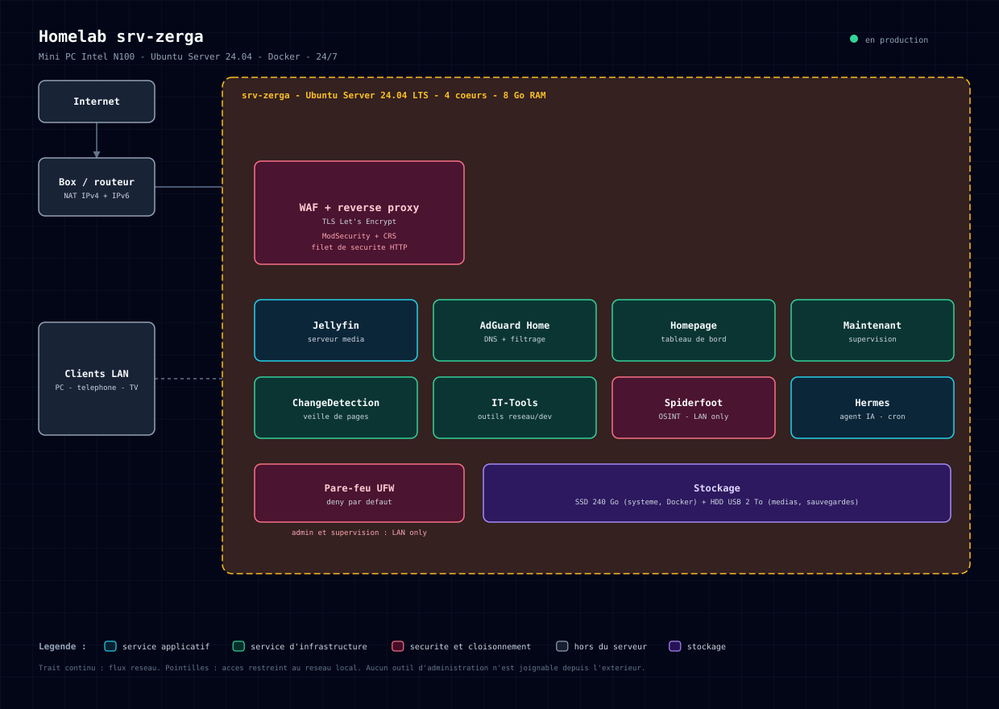

# Homelab srv-zerga

Un mini PC Intel N100 qui tourne 24/7 avec une dizaine de services auto-hébergés : DNS filtrant pour tout le réseau, serveur média, tableau de bord, supervision, veille de pages, coffre à outils. Derrière un WAF, avec une politique simple : rien n'est joignable depuis l'extérieur sauf ce qui doit l'être, et tout ce qui administre reste sur le réseau local.

Ce dépôt est la documentation de l'installation. Elle a été écrite à partir de l'inventaire réel de la machine (conteneurs, volumes, règles de pare-feu, stockage, sauvegardes), pas reconstituée de mémoire.

## La machine

| | |
|---|---|
| Serveur | Firebat ZY-AK2PLUS (mini PC) |
| CPU | Intel N100, 4 coeurs |
| RAM | 8 Go (7,5 Go utilisables, 4 Go de swap) |
| Stockage | SSD 240 Go (système et Docker) + HDD USB 2 To (médias et sauvegardes) |
| OS | Ubuntu Server 24.04 LTS |
| Réseau | Filaire uniquement, Wi-Fi désactivé |
| Consommation | environ 20 W, soit moins de 3 € par mois |

## Les services

Huit conteneurs actifs, tous épinglés par digest d'image.

| Service | Rôle | Accès |
|---|---|---|
| BunkerWeb | WAF et reverse proxy, TLS automatique | seul point d'entrée depuis l'extérieur |
| Jellyfin | Serveur média | distant via le WAF, local en direct |
| AdGuard Home | DNS et filtrage de publicités pour tout le réseau | réseau local |
| Homepage | Tableau de bord des services | réseau local |
| Maintenant | Supervision, découverte automatique des conteneurs, alertes | réseau local |
| ChangeDetection | Veille sur des pages web | réseau local |
| IT-Tools | Boîte à outils réseau et développement | réseau local |
| Spiderfoot | Reconnaissance OSINT | réseau local uniquement |
| Hermes | Agent personnel, tâches planifiées et sauvegardes | service système |

Le détail de chaque service, sa consommation mémoire et les choix d'images sont dans [services.md](services.md).

## Les pages

- [Architecture et réseau](architecture.md) : comment le trafic entre et circule, ce qui est exposé et ce qui ne l'est pas
- [Services](services.md) : la stack Docker, rôle et empreinte de chaque conteneur
- [Stockage et sauvegardes](stockage-sauvegardes.md) : organisation des disques, ce qui est sauvegardé et ce qui ne l'est pas encore
- [Supervision](supervision.md) : ce qui est surveillé et comment je suis alerté
- [Sécurité](securite.md) : pare-feu, cloisonnement, politique de mise à jour
- [Incidents et leçons](incidents-et-lecons.md) : ce qui a cassé, pourquoi, et ce que j'en ai tiré

## Ce que ça m'apporte

C'est un terrain d'entraînement qui tourne en production, utilisé tous les jours par la maison : le serveur média sert à ma famille, le DNS filtrant protège tout le réseau, l'agent planifie les sauvegardes. La différence avec un lab de formation, c'est que la panne est réelle, l'utilisateur râle, et il faut comprendre vite. C'est comme ça que j'ai appris à inspecter un conteneur avant de le recréer, à épingler une image par digest, ou à documenter une règle de pare-feu avant de l'oublier.

## Points ouverts

Une doc honnête dit aussi ce qui reste à faire.

- Les configurations Docker (volumes montés en bind) ne sont pas encore sauvegardées automatiquement
- SSH est encore accessible par mot de passe, l'objectif est de passer en clé uniquement
- Quatre conteneurs arrêtés et une vingtaine de gigaoctets d'images inutilisées attendent un nettoyage
- Aucune redondance matérielle : le serveur est un point de défaillance unique, et le disque des médias est en USB

## Méthode

Inventaire relevé directement sur la machine, sorties de commandes réelles. Les éléments datés le sont volontairement : cette documentation décrit un état, elle n'est pas intemporelle.
